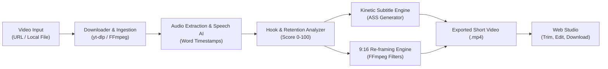

<div align="center">

# 🚀 ViralForge AI
### Open-Source AI Video Clipping & Re-framing Engine
**Transform long-form videos into engaging 9:16 vertical shorts automatically.**

[](https://opensource.org/licenses/MIT)
[](https://www.python.org/downloads/)
[](https://www.docker.com/)

[**Quickstart**](#-quickstart) •
[**Features**](#-features) •
[**Web Studio**](#-in-browser-video-studio) •
[**Docker**](#-docker-deployment) •
[**Architecture**](#-architecture)

</div>

---

## ⚡ Highlights

ViralForge AI is a self-hosted, open-source video processor that automates short-form video creation:
- **Speech & Hook Detection**: Locates high-retention segments using sentiment, audio velocity, and language models.
- **Dynamic 9:16 Re-framing**: Converts 16:9 widescreen videos into vertical video with blurred background padding or center focus.
- **Kinetic Karaoke Subtitles**: Burns animated word-by-word highlighted captions using FFmpeg.
- **In-Browser Video Studio**: Visual timeline trimmer, caption text editor, and instant exporter.
- **100% Self-Hosted & Free**: No subscriptions, no usage caps, and no watermarks.

---

## 🎯 Features

- 📥 **Flexible Ingestion**: Paste any video link (YouTube, social video) or upload local MP4/MOV files.
- 🎙️ **Speech-to-Text with Word Timestamps**: Fast transcription using Whisper / faster-whisper.
- 📊 **Virality Scoring (0-100)**: Evaluates hook strength, speech pacing, and retention curve.
- ✨ **Animated Subtitle Presets**:
  - `Vibrant Gold`: Energetic yellow active word highlighting.
  - `Neon Green`: High-contrast bold active word emphasis.
  - `Cyber Cyan`: Modern electric cyan accent.
  - `Clean Modern`: Subtle, minimalist caption style.
- 🎛️ **Interactive In-Browser Editor**:
  - Fine-tune start and end trim timestamps.
  - Correct or rewrite subtitles directly.
  - Toggle between 9:16 Blurred Stack, 9:16 Crop, or Original Aspect Ratio.
  - Re-render exports in seconds.

---

## 🚀 Quickstart

### Prerequisites
Make sure **FFmpeg** is installed:
- **Ubuntu/Debian**: `sudo apt update && sudo apt install -y ffmpeg`
- **macOS**: `brew install ffmpeg`
- **Windows**: `winget install Gyan.FFmpeg`

### Installation & Run

```bash
# 1. Clone the repository
git clone https://github.com/your-username/viralforge-ai.git
cd viralforge-ai

# 2. Run the startup script
# Linux / macOS:
chmod +x run.sh
./run.sh

# Windows:
run.bat
```

Alternatively, run manually with Python:

```bash
python3 -m venv venv
source venv/bin/activate       # On Windows: venv\Scripts\activate
pip install -r requirements.txt
python3 -m uvicorn app.main:app --host 0.0.0.0 --port 8000 --reload
```

Open your browser to: **`http://localhost:8000`**

---

## 🐳 Docker Deployment

Run isolated with Docker Compose:

```bash
docker compose up --build
```
Access the application at `http://localhost:8000`.

---

## 📐 Architecture



---

## 📄 License

Distributed under the **MIT License**.
